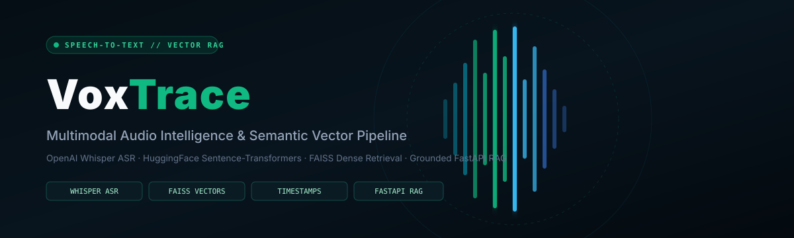
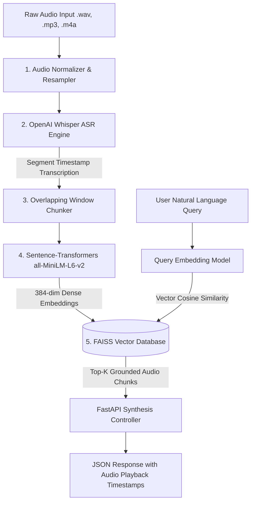

<div align="center">



<br/>

[](https://python.org)
[](https://fastapi.tiangolo.com)
[](https://github.com/openai/whisper)
[](https://github.com/facebookresearch/faiss)
[](https://huggingface.co)
[](LICENSE)

<p align="center">
  <b>High-Throughput Audio Speech-to-Text Transcription · Dense Vector Indexing · Grounded Semantic RAG</b>
</p>

</div>

---

## 📌 Overview

**VoxTrace** is an end-to-end multimodal audio intelligence and semantic retrieval engine. It converts unstructured spoken audio streams (`.wav`, `.mp3`, `.m4a`, `.ogg`) into searchable, timestamp-indexed vector memory. By combining **OpenAI Whisper** for automatic speech recognition (ASR), **Hugging Face Sentence-Transformers** for embedding generation, and **FAISS** for millisecond-latency vector similarity search, VoxTrace allows users to query long-form audio archives semantically via an asynchronous **FastAPI** backend.

---

## 🏗️ Architecture



---

## 🚀 Key Capabilities

- **Deep Speech Recognition:** Powered by Whisper with automatic language detection, punctuation restoration, and microsecond-level segment alignment.
- **Sub-Millisecond Vector Retrieval:** FAISS `IndexFlatIP` / `IndexIVFFlat` index for instant semantic retrieval across thousands of audio hours.
- **Context-Preserving Chunking:** Uses sliding overlapping token windows to guarantee acoustic and semantic continuity across speaker transitions.
- **Production-Ready FastAPI Service:** Fully asynchronous endpoints with Pydantic v2 schemas, automated Swagger documentation, and health monitoring.

---

## ⚡ Quickstart

### 1. Clone & Set Up Virtual Environment

```bash
git clone https://github.com/DeepxkJadhav/VoxTrace.git
cd VoxTrace

python -m venv .venv
# Linux/macOS:
source .venv/bin/activate
# Windows:
.\.venv\Scripts\activate

pip install -r requirements.txt
```

### 2. Launch FastAPI Server

```bash
uvicorn app.main:app --host 0.0.0.0 --port 8000 --reload
```

Interactive OpenAPI documentation is live at: [http://localhost:8000/docs](http://localhost:8000/docs)

---

## 📡 REST API Reference

### `POST /api/v1/transcribe-and-index`
Ingests an audio file, generates timestamped segments via Whisper, creates embeddings, and adds them to the live FAISS index.

**Request:**
```bash
curl -X POST "http://localhost:8000/api/v1/transcribe-and-index" \
     -H "accept: application/json" \
     -H "Content-Type: multipart/form-data" \
     -F "file=@meeting_recording.mp3"
```

**Response:**
```json
{
  "status": "success",
  "filename": "meeting_recording.mp3",
  "duration_seconds": 184.2,
  "segments_indexed": 18,
  "language_detected": "en"
}
```

---

### `POST /api/v1/query`
Executes semantic similarity search over the audio index and returns matching transcript segments with precise start/end timestamps.

**Request:**
```bash
curl -X POST "http://localhost:8000/api/v1/query" \
     -H "Content-Type: application/json" \
     -d '{"query": "What were the quarterly revenue targets?", "top_k": 3}'
```

**Response:**
```json
{
  "query": "What were the quarterly revenue targets?",
  "results": [
    {
      "start_time": "01:24.500",
      "end_time": "01:42.100",
      "text": "Our target for Q3 is to achieve 25% ARR growth with an expansion into APAC markets.",
      "confidence_score": 0.892
    }
  ]
}
```

---

## 🛠️ Tech Stack

| Component | Framework / Library | Purpose |
|---|---|---|
| **ASR Engine** | OpenAI Whisper | Audio speech-to-text with timestamps |
| **Embeddings** | `sentence-transformers/all-MiniLM-L6-v2` | Dense semantic text representation |
| **Vector Search** | Facebook AI Similarity Search (FAISS) | High-speed vector nearest neighbor lookup |
| **API Backend** | FastAPI + Uvicorn + Pydantic v2 | High-throughput asynchronous REST server |
| **Audio I/O** | Librosa / SoundFile / FFmpeg | Audio stream decoding, normalization & chunking |

---

## 📄 License

Distributed under the **MIT License**. Maintained with care by **Deepak Jadhav ([@DeepxkJadhav](https://github.com/DeepxkJadhav))**.
